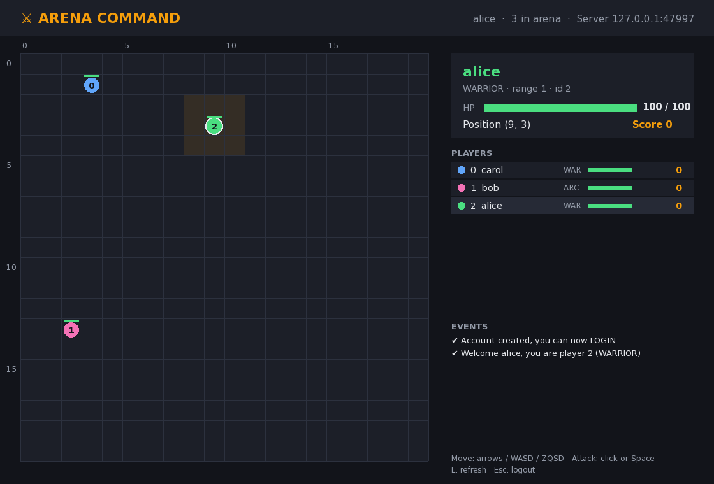
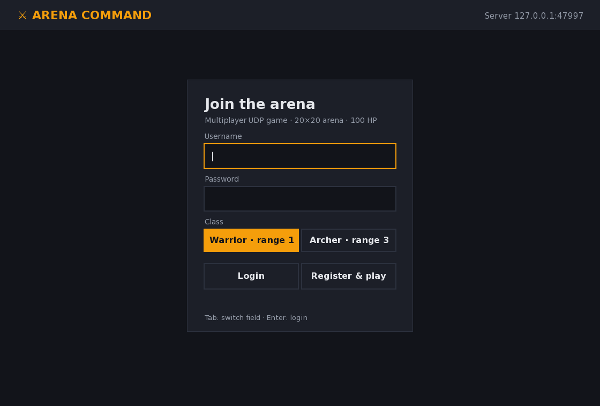
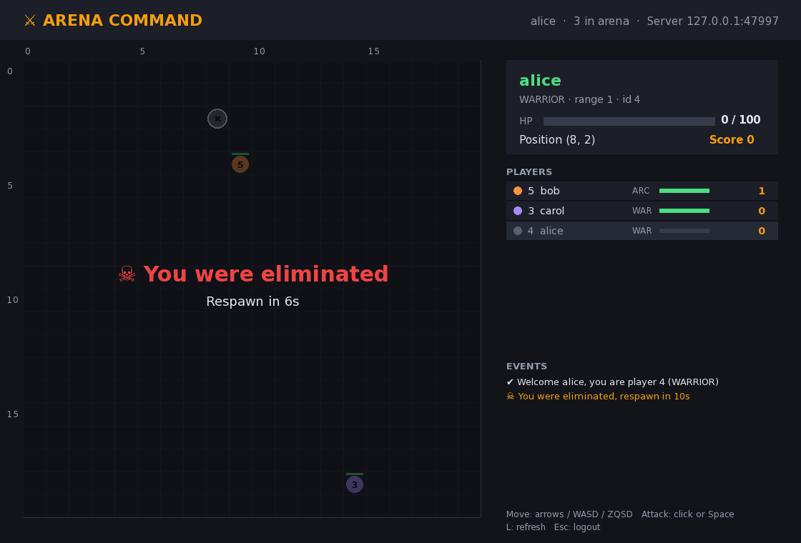
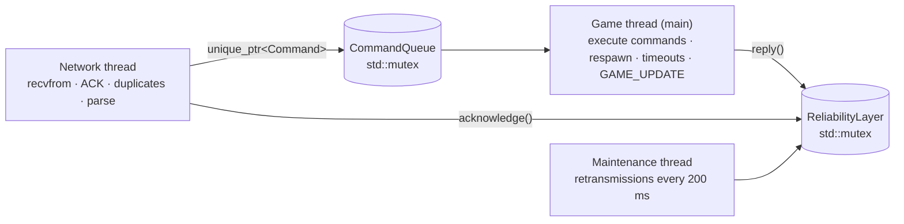
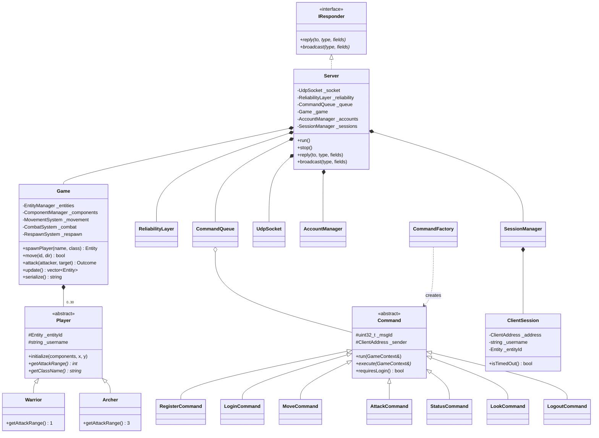
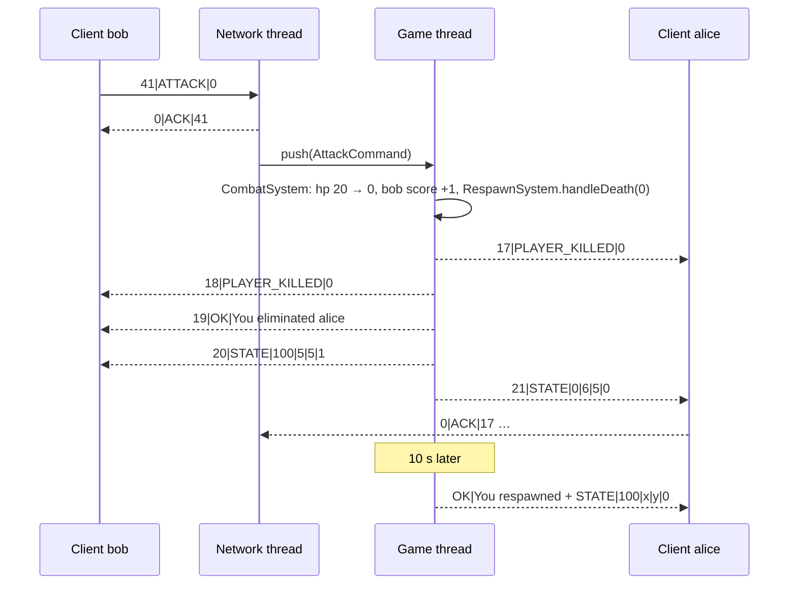

# Arena Command


**Multiplayer UDP game server with a terminal client and an SFML graphical client, in C++20**, built for the Tek-Réseau association (2nd-year project).

Players create an account, log in, enter a **20×20 arena**, move, attack each other and score points. The server is the **single authority** on the game state. All traffic goes over **UDP**, with a home-made reliability layer on top: message IDs, ACKs, timeouts, retransmission and duplicate detection.



<details>
<summary>Terminal client</summary>

```
=== ARENA COMMAND ===  alice  HP 80  pos (6,4)  score 1

    0 1 2 3 4 5 6 7 8 9 0 1 2 3 4 5 6 7 8 9
  0 . . . . . . . . . . . . . . . . . . . .
  ...
  4 . . . . . . @ . 1 . . . . . . . . . . .
  ...
Players:
  [0] alice WARRIOR  80 HP  (6,4)  score 1  <- you
  [1] bob ARCHER  100 HP  (8,4)  score 0
```
</details>

## Features

| Area | What is implemented |
|---|---|
| Game rules | 100 HP at spawn, 20 damage per attack, death at HP ≤ 0, automatic respawn after 10 s, +1 score per kill |
| Classes | `Warrior` (melee, range 1) and `Archer` (range 3), both inheriting from the abstract `Player` |
| UDP reliability | Unique message IDs, `ACK`, 3 s timeout, retransmission (up to 5 sends), duplicate filtering |
| Authentication | `REGISTER` / `LOGIN` with PBKDF2-SHA256 + random salt, persistent accounts, one session per account |
| Sessions | Identified by IP + port, 60 s inactivity timeout, clients send a `PING` after 20 s without input, clean `LOGOUT` |
| Security | Strict input validation (format, length, charset), brute-force limit (5 failed logins per IP per minute) |
| Terminal client | Interactive CLI with a live 20×20 ASCII grid, WASD/ZQSD shortcuts |
| Graphical client (bonus) | SFML window: login form, live arena, range overlay, click-to-attack, HP bars, scoreboard, respawn countdown |
| Testing | 39-check end-to-end test suite over real UDP, plus a packet-loss simulation flag |

## Build

Requirements: Linux, a C++20 compiler (g++ ≥ 10 or clang ≥ 12), CMake ≥ 3.10, OpenSSL (`libssl-dev`), and SFML 2.5+ (`libsfml-dev`) for the graphical client. If SFML is missing, only `arena_gui` is skipped.

```bash
make            # = cmake -S . -B build && cmake --build build
make re         # full rebuild
make tests_run  # build + end-to-end tests (needs python3)
```

The build produces `arena_server`, `arena_client` and `arena_gui` at the repository root.

## Run

```bash
./arena_server                      # listens on UDP 4242, accounts stored in users.db
./arena_client                      # connects to 127.0.0.1:4242
./arena_client 192.168.1.20 4242    # another machine
```

```bash
./arena_gui                         # graphical client (run it from the repository root)
./arena_gui 192.168.1.20 4242 --user alice --password secret --archer
```

Server options: `-p PORT`, `--users FILE`, `--timeout SECONDS`, `--loss RATIO`, `--seed N`.
Terminal client options: `[HOST] [PORT] --loss RATIO`.
Graphical client options: `[HOST] [PORT] --loss RATIO --user NAME --password PASS [--archer] [--register] [--screenshot FILE --delay S]`.

### Graphical client (bonus)

| Login | In game | Eliminated |
|---|---|---|
|  |  |  |

| Input | Action |
|---|---|
| Arrows, WASD or ZQSD | Move |
| Click on a player | `ATTACK` that player |
| Space | Attack the nearest enemy in range |
| L | `LOOK` (refresh the arena) |
| Esc | `LOGOUT` |

Your attack range is highlighted around your token. A hovered enemy turns red when you can click to attack it, and a token flashes red when it takes damage. `--screenshot` renders off-screen without opening a window, which is how the images above were produced.

### Client commands

| Typed | Sent to the server |
|---|---|
| `register alice secret` | `REGISTER\|alice\|secret` |
| `login alice secret [warrior\|archer]` | `LOGIN\|alice\|secret\|ARCHER` |
| `w` `a` `s` `d` (or `z` `q` `s` `d`, `up`, `move left`…) | `MOVE\|UP` … |
| `attack 3` | `ATTACK\|3` |
| `status` · `look` · `logout` | `STATUS` · `LOOK` · `LOGOUT` |
| `help` · `quit` | local |

### Try the reliability layer

```bash
./arena_server --loss 0.3          # drops 30% of packets in and out
./arena_client 127.0.0.1 4242 --loss 0.3
```

Every command still goes through. The server log shows each `Retransmit` and each ignored `Duplicate`.

## Network protocol

Every datagram, in both directions, follows the official format:

```
MSGID|TYPE|FIELD1|FIELD2|...
```

- `MSGID` is a positive integer of up to 9 digits, unique per sender. The receiver must answer `0|ACK|MSGID`.
- `MSGID = 0` marks a message that expects **no ACK**. This applies to `ACK` itself and to the periodic `GAME_UPDATE` broadcast.
- Fields cannot contain `|` or control characters. A datagram is at most 1472 bytes, and each field at most 64 characters.

### Client → server

| Message | Fields | Answer |
|---|---|---|
| `REGISTER` | `username` (3-16 `[A-Za-z0-9_]`), `password` (4-32 printable) | `OK` / `ERROR` |
| `LOGIN` | `username`, `password`, optional `WARRIOR`/`ARCHER` (default `WARRIOR`) | `OK\|Welcome alice, you are player 0 (WARRIOR)` + `STATE` |
| `MOVE` | `UP` / `DOWN` / `LEFT` / `RIGHT` | `STATE` (+ `ERROR` if blocked by the border or dead) |
| `ATTACK` | `player_id` | `OK\|Hit bob (60 HP left)` + `STATE`, or `ERROR` (out of range, dead, unknown…) |
| `STATUS` | — | `STATE` |
| `LOOK` | — | `GAME_UPDATE` |
| `LOGOUT` | — | `OK\|Goodbye alice` |
| `PING` | — | `ACK` only. Keep-alive, also accepted before `LOGIN` |

### Server → client

| Message | Fields | Reliable |
|---|---|---|
| `ACK` | acknowledged `MSGID` | no (`MSGID` 0) |
| `OK` | human-readable message | yes |
| `ERROR` | human-readable reason | yes |
| `STATE` | `HP`, `X`, `Y`, `SCORE` | yes |
| `PLAYER_KILLED` | `player_id` (sent to every player) | yes |
| `GAME_UPDATE` | `id,name,class,hp,x,y,score;id,name,…` | as an answer to `LOOK`: yes. As a broadcast: no |

### Example exchange

```
client → 12|LOGIN|alice|secret|ARCHER
server → 0|ACK|12
server → 1|OK|Welcome alice, you are player 0 (ARCHER)
client → 0|ACK|1
server → 2|STATE|100|7|13|0
client → 0|ACK|2
client → 13|ATTACK|1
server → 0|ACK|13
server → 3|ERROR|bob is out of range (your range: 3)
```

## Reliability over UDP

`ReliabilityLayer` is shared by the client and the server:

| Mechanism | Implementation |
|---|---|
| Unique ID | `std::atomic<uint32_t>` counter. The client starts at a random value, so a restarted client is not mistaken for a duplicate. |
| ACK | Every message with `MSGID > 0` is acknowledged immediately by the network thread, including duplicates, because the previous ACK may have been lost. |
| Timeout | Each pending message stores the time it was last sent (`std::chrono::steady_clock`). |
| Retransmission | A maintenance thread resends every 3 s and gives up after 5 sends. |
| Duplicates | A per-peer `unordered_set` of received IDs, bounded with a FIFO to 1024 IDs. A duplicate is ACKed again but never executed twice. |

`GAME_UPDATE` is deliberately **unreliable**: each update replaces the previous one, so retransmitting an outdated state would be pointless. It is broadcast at most every 100 ms when something changes, plus a 2 s keep-alive that makes up for losses.

In the other direction, the clients send a reliable `PING` when the player has sent nothing for 20 s. A player who is only watching therefore keeps their session, while a client that crashed or lost the network still expires after the 60 s timeout.

## Architecture

```
include/ src/
├── ecs/        EntityManager, ComponentManager (+ .tpp)    entity-component storage
├── components/ Health, Position, Score                     plain data
├── entities/   Player (abstract), Warrior, Archer          inheritance + polymorphism
├── systems/    MovementSystem, CombatSystem, RespawnSystem game rules
├── game/       Game, GameContext                           authoritative state
├── command/    Command (abstract) + 7 commands + factory   Command pattern
├── auth/       AccountManager                              accounts and hashing
└── network/    UdpSocket, ProtocolParser, ReliabilityLayer, ClientSession, CommandQueue, Server
client/common/  NetworkClient, ClientState                 shared client core (reliable link + game view)
client/cli/     Client, ArenaView                           terminal client
client/gui/     GuiApp                                      SFML graphical client
assets/fonts/   DejaVu Sans                                 GUI font (free licence, see LICENSE-DejaVu.txt)
tests/          e2e_test.py                                 end-to-end tests
```

### Threads (server)



Only the game thread touches `Game` and `SessionManager`, so the game logic needs no locking. The only shared structures are `CommandQueue` and `ReliabilityLayer`, and both are protected by a mutex.

### Class diagram



### Sequence: an attack that kills



## Technical choices

- **ECS + inheritance.** Game data lives in the ECS (`ComponentManager`, an `unordered_map` per component type), while the class-specific behaviour (`getAttackRange`) uses the `Player` → `Warrior`/`Archer` hierarchy. This gives us both the required OOP concepts and a data layout that stays easy to extend.
- **Command pattern.** The network thread only parses and validates input. `CommandFactory` builds the `unique_ptr<Command>` and the game thread executes it. `Command::run()` is a template method that handles the login check, activity tracking and exceptions in one place, so every command implements only `execute()`.
- **`IResponder` interface.** Commands send replies without knowing about sockets, which keeps the game logic testable and decoupled from the network.
- **One client core, two front ends.** `NetworkClient` (protocol and reliability) and `ClientState` (the game as seen by the player) are shared by the terminal and SFML clients. In the GUI, the network thread only pushes messages into a mutex-protected queue, and the render thread applies them every frame, so no drawing code ever needs a lock.
- **`std::map` keyed by message ID** for pending packets, giving ordered, cheap removal on ACK. **`std::unordered_set`** gives O(1) duplicate detection.
- **RAII everywhere.** `UdpSocket` closes its descriptor in its destructor, `Server` joins its threads, and `std::unique_ptr` owns commands, players and sessions.
- **Exceptions** (`SocketError`, `ProtocolError`) for invalid input and system failures. A malformed datagram never crashes the server: it gets an `ERROR` reply.
- **Password storage.** PBKDF2-HMAC-SHA256 with 10,000 iterations and a 16-byte random salt per account, compared in constant time (`CRYPTO_memcmp`). The login error message is identical for an unknown user and a wrong password, so it does not reveal which accounts exist.

## Tests

```bash
make tests_run
```

`tests/e2e_test.py` starts a real server and talks to it over UDP. It runs 39 checks covering:
- protocol errors and input validation;
- the reliability layer (ACKs, duplicates executed once, retransmission after 3 s);
- authentication and hashed storage;
- movement, combat, `PLAYER_KILLED`, score, and respawn after 10 s;
- `LOGOUT`, the inactivity timeout, and the brute-force limit.

## Team

- **Harry Sègnon HOUNSOU** ([@Harry06-X](https://github.com/Harry06-X)): network engine and protocol
- **Sandy Gbaguidi**: gameplay systems and client
